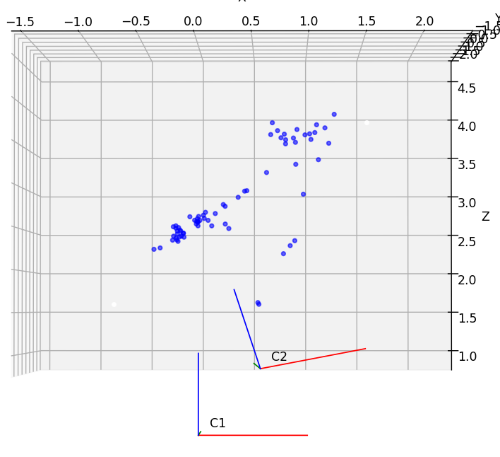
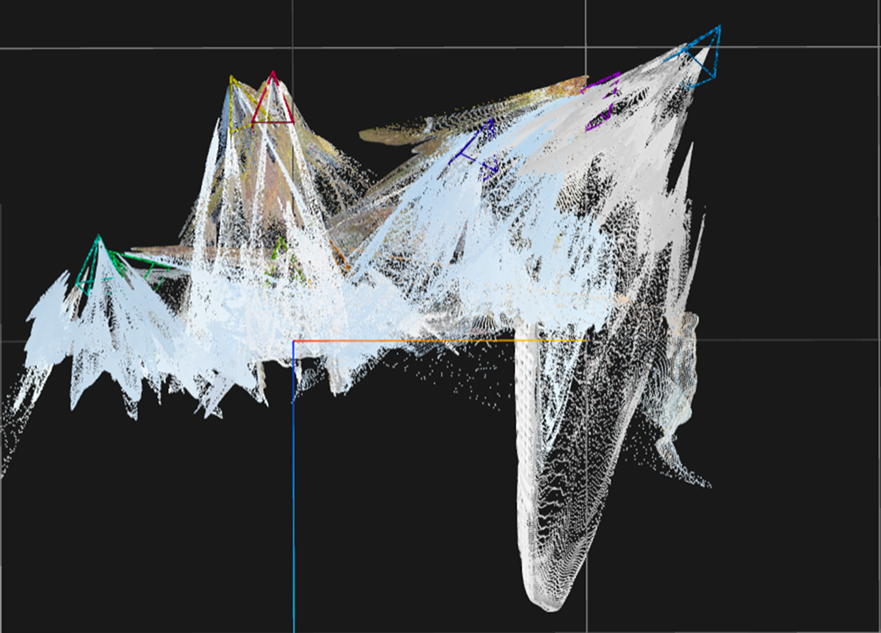
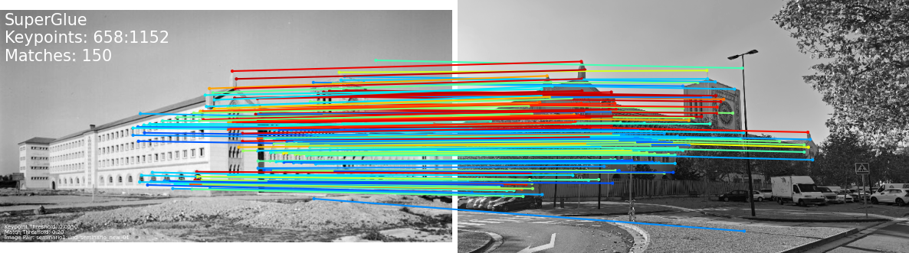
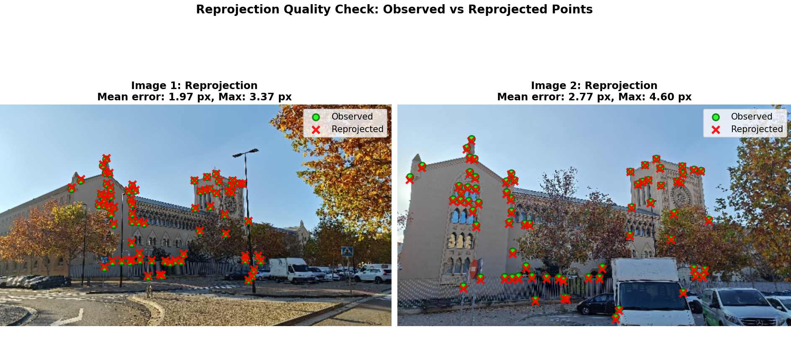
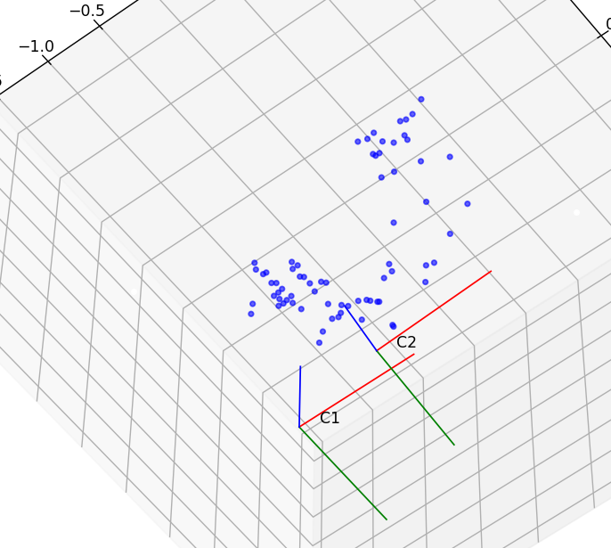
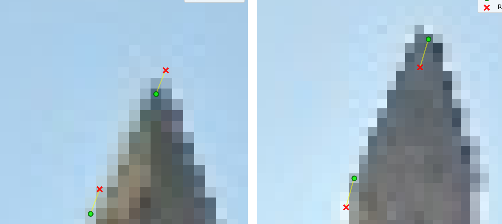

# 3D Structure from Motion (SfM): Real Seminario de Zaragoza

> **Sparse & Dense 3D Reconstruction from Archival (c. 1950) and Modern Photographs**  
> *Academic Framework: Computer Vision & Multi-View Geometry*  
> *Pipeline: Intrinsic Calibration, SuperGlue Matching, Hartley SVD Epipolar Geometry, DLT Triangulation, RANSAC Homography, and VGGT*

---

> [!IMPORTANT]
> **Academic Project & Educational Notice**  
> This repository contains the code and experimental results of an academic coursework project in computer vision. All theoretical frameworks and baseline models (SuperGlue, LightGlue, Hartley-Zisserman MVG, and VGGT) belong and are fully attributed to their original authors. This project is shared strictly for educational and technical demonstration purposes.

---

## 📌 Problem Statement

The goal of this project is to reconstruct the 3D geometry of the historical façade of the **Real Seminario de Minería de Zaragoza** by pairing two visual sources across an extreme temporal and technological gap:
1. An **archival black-and-white photograph** (taken circa 1950, without camera metadata, with analog film grain, and at an unknown focal length).
2. **Modern digital photographs** captured from multiple campus vantage points using a calibrated camera.

### Key Challenges
* **70+ Year Domain Gap:** Substantial tree and foliage growth, modern vehicle parking, and physical stone aging across decades.
* **Uncalibrated Historical Camera:** Reconstructing metric poses $[R \mid \mathbf{t}]$ requires resolving epipolar geometry between an unknown legacy analog camera and a modern digital sensor.

---

## 🛠️ Implementation Overview

The complete Structure from Motion (SfM) pipeline links calibration to 3D point cloud triangulation:

```
[ Historical Photo (1950) ]           [ Modern Digital Captures ]
            |                                       |
            |                                       v
            |                         [ Intrinsic Calibration K ]
            |                         (Checkerboard + Undistortion)
            |                                       |
            +-------------------+-------------------+
                                |
                                v
               [ SuperGlue Feature Matching (GNN) ]
               (Keypoint & descriptor extraction)
                                |
                                v
               [ Outlier Rejection via RANSAC ]
                 (71 inliers / 33 rejected)
                                |
                                v
               [ Normalized Epipolar Geometry ]
             (Hartley Isotropic + Essential SVD)
                                |
                                v
                 [ DLT 3D Triangulation ]
             (3D Point Cloud + RMSE 2.110 px)
                                |
                                v
               [ Dense Neural Geometry (VGGT) ]
```

### 1. Camera Calibration & Preprocessing
* **`src/camera_calibration.py`:** Calibrates the modern camera using a $9 \times 6$ checkerboard target, computing the intrinsic matrix $K$ and radial distortion coefficients $(k_1, k_2)$ to undistort all modern frames.
* **`src/cutting_camera.py`:** Standardizes aspect ratios and FOV between historical and modern frames to $682 \times 384\,\text{px}$, centering the principal point.

### 2. Feature Matching & Inlier Rejection
* **`src/matches_in_between_points.py`:** Processes SuperGlue candidate correspondences, systematically filtering out false positives caused by moving tree leaves, shadows, and parked car windshields.
* **`src/homographyRANSAC.py`:** Estimates robust planar homographies with RANSAC to verify coplanarity across architectural moldings.

### 3. Epipolar Pipeline & 3D Triangulation
* **`src/global_assignment.py` & `src/sfm_epipolar_pipeline.py`:**
  * Applies Hartley isotropic normalization to 2D coordinates to ensure numerical conditioning.
  * Solves Fundamental ($F$) and Essential ($E$) matrices via Singular Value Decomposition (SVD).
  * Decomposes $E$ into relative camera rotation $R$ and translation $\mathbf{t}$.
  * Triangulates corresponding rays via Direct Linear Transform (DLT) to produce 3D coordinates.

### 4. Dense Neural Reconstruction (VGGT)
* Leveraged the **VGGT** (*Visual Geometry Grounded Transformer*) model to generate a dense, continuous 3D point cloud of the historical façade.

---

## 📊 Quantitative Results & Evidence

* **Initial Matching Candidates:** 104 correspondences.
* **Verified Geometric Inliers:** **71 points (68.3%)**.
* **Filtered Outliers:** **33 points (31.7%)** (discarded background trees, dynamic artifacts).
* **Reprojection Error (Camera 1):**
  * **RMSE:** **2.110 pixels**.
  * **Mean Error:** **1.969 pixels**.

| 3D Point Cloud & Camera Poses | Dense Neural Reconstruction (VGGT) |
| :---: | :---: |
|  |  |

| SuperGlue Inlier Correspondences | Reprojection Error Verification |
| :---: | :---: |
|  |  |

| Top-Down Camera Poses View | Reprojection Error Distribution (RMSE) |
| :---: | :---: |
|  |  |

---

## 📁 Repository Structure

```text
seminario_zaragoza_sfm/
├── README.md                                 <- Master documentation
├── .gitignore                                <- Git ignore rules
├── docs/
│   ├── Seminario_1.pptx                      <- Full 28-slide technical presentation
│   ├── CVIS_Course_Assignment_2025_26.pdf    <- Course specification
│   ├── Pipeline.drawio                       <- Architecture diagram
│   ├── 1_Inputs.drawio                       <- Input schema diagram
│   └── images/                               <- Point clouds, renders, error plots
├── src/
│   ├── camera_calibration.py                 <- Checkerboard calibration & undistortion
│   ├── global_assignment.py                  <- Master SfM pipeline (SVD, poses, DLT)
│   ├── global_assignment_2.py                <- Multi-view extended pipeline
│   ├── homographyRANSAC.py                   <- Robust planar homography
│   ├── cutting_camera.py                     <- Aspect ratio & FOV matching
│   ├── matches_in_between_points.py          <- SuperGlue match parser and filter
│   ├── sfm_epipolar_pipeline.py              <- Standalone epipolar verification
│   ├── utilities.py                          <- SE(3) matrix assembly & 3D plotting
│   └── utilities2.py                         <- Additional geometric utilities
├── data/
│   ├── calibration/                          <- Intrinsic calibration files
│   ├── raw_images/                           <- Historical (1950) and modern captures
│   ├── undistorted/                          <- Undistorted corrected frames
│   └── matches/                              <- Extracted .npz match arrays
└── results/                                  <- Numerical outputs
```

---

## 🚀 Quickstart Guide

### 1. Requirements & Dependencies
```bash
pip install numpy opencv-python matplotlib scipy
```

### 2. Calibrate Camera Intrinsics
```bash
python src/camera_calibration.py
```

### 3. Run Structure from Motion
Calculates camera poses and triangulates the 3D point cloud:
```bash
python src/global_assignment.py
```

### 4. Estimate Planar Homographies
```bash
python src/homographyRANSAC.py
```

---

## 📄 Technical Presentation
The complete 28-slide presentation detailing each mathematical step, matrix derivations, and visual comparisons is available at [`docs/Seminario_1.pptx`](docs/Seminario_1.pptx).
