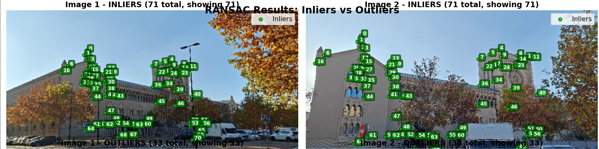

# 3D Structure from Motion (SfM): Real Seminario de Zaragoza

> **Sparse & Dense 3D Reconstruction from Historical (circa 1950) and Modern Photographs**  
> *Academic Framework: Computer Vision & Multi-View Geometry*  
> *Core Algorithms: Intrinsic Calibration, SuperGlue GNN Matching, Hartley-Normalized Epipolar SVD, DLT Triangulation, RANSAC Homography, and VGGT Neural Geometry*

---

> [!IMPORTANT]
> **Academic Reproduction & Educational Purpose Notice**  
> This repository contains an academic coursework implementation and experimental project developed strictly for educational, research, and benchmarking purposes in computer vision. All algorithmic foundations (SuperGlue, LightGlue, Hartley-Zisserman MVG, and VGGT) are fully attributed to their original authors. There is no intent of commercial exploitation or plagiarism.

---

## Quick Navigation Index

| Section | Description | Direct Link |
| :--- | :--- | :--- |
| **System Overview** | Problem statement, historic vs. modern imagery challenges | [System Overview](#system-overview) |
| **Mathematical Formulation** | Epipolar algebra, Hartley normalization, DLT triangulation, SVD | [Mathematical Formulation](#mathematical-formulation) |
| **Experimental Results** | Reprojection error, RMSE metrics, inlier distribution, 3D point cloud | [Experimental Results](#experimental-results) |
| **Repository Structure** | Organized layout of source scripts, data, and docs | [Repository Structure](#repository-structure) |
| **Execution Guide** | Step-by-step instructions to run calibration, matching, and SfM | [Execution Guide](#execution-guide) |
| **Documentation & Slides** | Link to full presentation (28 slides) and specification | [Documentation](#documentation) |

---

## System Overview

This project reconstructs the 3D geometry of the historical **Real Seminario de Minería de Zaragoza** by bridging extreme visual domain gaps between archive black-and-white photography (circa 1950) and modern calibrated digital captures.

```
+---------------------------+       +---------------------------+
|  Historical Image (1950)  |       |   Modern Image (Calib)    |
| (Aspect ratio, no intrins)|       |  (Radial undistortion K)  |
+-------------+-------------+       +-------------+-------------+
              |                                   |
              +-----------------+-----------------+
                                |
                                v
               [ SuperGlue GNN Feature Matching ]
                                |
                                v
             [ Inlier / Outlier Rejection & RANSAC ]
                     (71 Inliers / 33 Outliers)
                                |
                                v
            [ Hartley-Normalized 8-Point Essential SVD ]
                                |
                                v
              [ DLT 3D Triangulation & Reprojection ]
                    (RMSE: 2.110 px on Camera 1)
                                |
                                v
              [ VGGT Dense Neural Geometry Output ]
```

### Visual Highlights

| 3D Point Cloud & Camera Poses | Dense Neural Reconstruction (VGGT) |
| :---: | :---: |
|  |  |

| SuperGlue Feature Correspondences | Reprojection Error Verification |
| :---: | :---: |
|  |  |

---

## Mathematical Formulation

### 1. Camera Calibration and Radial Undistortion
Modern captures are calibrated with a $9 \times 6$ checkerboard target to obtain the intrinsic matrix $K$ and radial distortion coefficients $(k_1, k_2)$:
$$K = \begin{bmatrix} f_x & 0 & c_x \\ 0 & f_y & c_y \\ 0 & 0 & 1 \end{bmatrix}, \quad \begin{cases} x_{\text{undist}} = x(1 + k_1 r^2 + k_2 r^4) \\ y_{\text{undist}} = y(1 + k_1 r^2 + k_2 r^4) \end{cases}$$
Images are resized and center-aligned to standardized dimensions ($682 \times 384\,\text{px}$) with principal point $(c_x = 341, c_y = 192)$.

### 2. Epipolar Geometry & Hartley Isotropic Normalization
For two matching 2D points $\mathbf{x}_1, \mathbf{x}_2 \in \mathbb{P}^2$ across views, the epipolar constraint satisfies:
$$\mathbf{x}_2^\top F \mathbf{x}_1 = 0, \quad \hat{\mathbf{x}}_2^\top E \hat{\mathbf{x}}_1 = 0$$
where $E = [\mathbf{t}]_\times R = K_2^\top F K_1$. To avoid numerical degeneracy in the 8-point algorithm, Hartley's isotropic normalization transformation $T$ is applied:
$$T = \begin{bmatrix} \frac{\sqrt{2}}{\bar{d}} & 0 & -\frac{\sqrt{2}\bar{x}}{\bar{d}} \\ 0 & \frac{\sqrt{2}}{\bar{d}} & -\frac{\sqrt{2}\bar{y}}{\bar{d}} \\ 0 & 0 & 1 \end{bmatrix}, \quad \tilde{\mathbf{x}} = T \mathbf{x}$$
The Essential matrix is computed via Singular Value Decomposition ($A = U \Sigma V^\top$) enforcing rank-2 constraint $\Sigma = \text{diag}(1, 1, 0)$.

### 3. Direct Linear Transform (DLT) Triangulation
For each inlier correspondence, the 3D world coordinate $\mathbf{X}_i = [X, Y, Z, 1]^\top$ is estimated by solving the overdetermined homogeneous system:
$$\begin{bmatrix} [\mathbf{x}_{1, i}]_\times P_1 \\ [\mathbf{x}_{2, i}]_\times P_2 \end{bmatrix} \mathbf{X}_i = \mathbf{0}$$
where $P_1 = K_1 [I \mid \mathbf{0}]$ and $P_2 = K_2 [R \mid \mathbf{t}]$.

---

## Experimental Results

### Quantitative Metrics
* **Total SuperGlue Candidates:** 104 matches
* **Verified Geometric Inliers:** 71 matches (**68.3%**)
* **Filtered Outliers:** 33 matches (**31.7%**) — eliminating foliage moving leaves, background traffic, and transient illumination artifacts.
* **Reprojection Root Mean Square Error (RMSE):**
  $$\text{RMSE} = \sqrt{\frac{1}{N}\sum_{i=1}^N \|\mathbf{x}_{1, i} - \pi(P_1 \mathbf{X}_i)\|_2^2} = \mathbf{2.110\,\text{px}}$$
* **Mean Reprojection Error:** $\mathbf{1.969\,\text{px}}$

| Reprojection Error Distribution | Inliers vs Outliers Breakdown |
| :---: | :---: |
|  |  |

---

## Repository Structure

```text
seminario_zaragoza_sfm/
├── .gitignore
├── README.md                                 <- Master project documentation
├── docs/
│   ├── Seminario_1.pptx                      <- Full 28-slide technical presentation
│   ├── CVIS_Course_Assignment_2025_26.pdf    <- Academic specification
│   ├── Pipeline.drawio                       <- Editable architecture diagram
│   ├── 1_Inputs.drawio                       <- Input schema diagram
│   └── images/                               <- Renders, plots, and slide figures
├── src/
│   ├── camera_calibration.py                 <- Intrinsic calibration & undistortion
│   ├── global_assignment.py                  <- Master SfM pipeline (SVD, poses, DLT)
│   ├── global_assignment_2.py                <- Extended multi-view pipeline
│   ├── homographyRANSAC.py                   <- Robust planar homography
│   ├── cutting_camera.py                     <- Aspect ratio and FOV matching
│   ├── matches_in_between_points.py          <- SuperGlue match parser and filter
│   ├── sfm_epipolar_pipeline.py              <- Standalone epipolar verification
│   ├── utilities.py                          <- SE(3) matrix assemble & plotting
│   └── utilities2.py                         <- Additional geometric utilities
├── data/
│   ├── calibration/
│   │   ├── Calibration.txt                   <- Intrinsic calibration parameters
│   │   └── k_matrix.txt                      <- Formatted K matrix
│   ├── raw_images/                           <- Historic (1950) and modern captures
│   ├── undistorted/                          <- Undistorted corrected frames
│   └── matches/                              <- Extracted .npz match arrays
└── results/
```

---

## Execution Guide

### 1. Requirements & Dependencies
Ensure Python 3.9+ is installed:
```bash
pip install numpy opencv-python matplotlib scipy
```

### 2. Camera Calibration
Calibrate intrinsic parameters using the checkerboard dataset:
```bash
python src/camera_calibration.py
```

### 3. Run Structure from Motion
Execute the multi-view reconstruction pipeline:
```bash
python src/global_assignment.py
```

### 4. Planar Homography & Epipolar Verification
```bash
python src/homographyRANSAC.py
python src/sfm_epipolar_pipeline.py
```

---

## Documentation

* **Full Presentation:** [`docs/Seminario_1.pptx`](docs/Seminario_1.pptx) (Contains 28 detailed slides with all visual comparisons, error graphs, and camera trajectory).
* **Course Assignment Guidelines:** [`docs/CVIS_Course_Assignment_2025_26.pdf`](docs/CVIS_Course_Assignment_2025_26.pdf).
